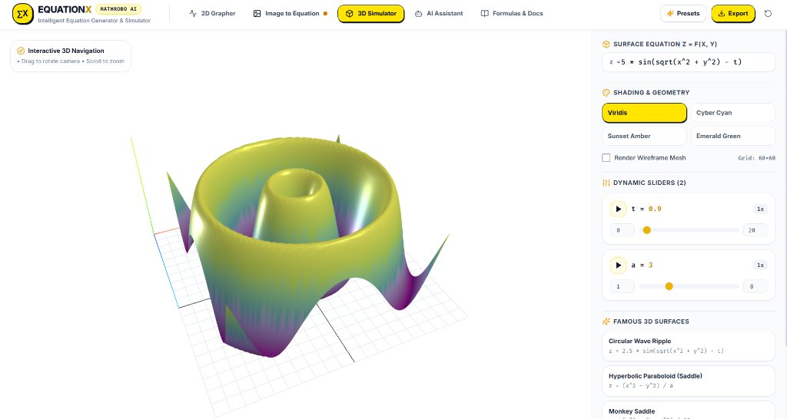

# EQUATIONX
### AI-Powered Equation Generator, Image-to-Equation Converter & Mathematical Graph Simulator

<p align="center">
  
</p>

**EQUATIONX** is a next-generation browser-based mathematical computing and visualization platform inspired by Desmos, featuring an **Image-to-Equation Conversion Pipeline**, a real-time **2D & 3D Graphing Calculator**, dynamic **Physics & Simulation Engine**, and an **AI Mathematical Assistant**.

---

##  Key Features & Modules

### 1.  MODULE 1: Image-to-Equation Converter
- **Image Upload & Preprocessing:** Drag-and-drop or file upload for PNG, JPG, JPEG, SVG, and WEBP. Includes a built-in library of sample silhouettes (Heart, Butterfly, Star, Apple, Infinity).
- **Computer Vision Pipeline:** Real-time spatial Sobel edge detection ($G_x, G_y$), 1D separable Gaussian smoothing for noise reduction, and Moore-neighbor boundary tracing.
- **Douglas-Peucker Simplification:** Dynamic polygonal curve simplification with user-adjustable $\epsilon$ tolerance to eliminate noise vertices while preserving salient geometry.
- **Multi-Method Mathematical Equation Generation:**
  - **Discrete Fourier Epicycles (Parametric):**
    $$x(t) = a_0 + \sum_{k=1}^N \left(2 a_k \cos(kt) - 2 b_k \sin(kt)\right)$$
    $$y(t) = c_0 + \sum_{k=1}^N \left(2 c_k \cos(kt) - 2 d_k \sin(kt)\right)$$
    Computes exact harmonic Fourier coefficients to reproduce any continuous contour.
  - **Polynomial Least-Squares Regression:**
    $$y = \sum_{j=0}^d c_j x^j$$
    Vandermonde normal equations with partial pivoting Gaussian elimination.
  - **Piecewise Monotonic Splines:**
    Segments complex shapes into piecewise Cartesian sections.
- **Optimization & Reconstruction Score:**
  - Real-time similarity accuracy metric calculated using normalized Root-Mean-Square Error (RMSE) against original contour geometry.
  - Controls for harmonic count, polynomial degree, and contour filtering.
- **One-Click 2D Graph Plotting & Overlay Comparison:**
  - Instantly plots generated equations on the 2D graph with an adjustable opacity slider overlaying the original image to visually verify mathematical reconstruction.

---

### 2.  MODULE 2: Advanced Mathematical Graphing Calculator
- **Equation Types Supported:**
  - **Cartesian:** $y = f(x)$, $x = g(y)$
  - **Parametric:** $(x(t), y(t))$ with custom $t_{\min} \le t \le t_{\max}$
  - **Polar:** $r = f(\theta)$ with concentric polar grid and radial rays
  - **Implicit:** $F(x, y) = 0$ (e.g., $x^2 + y^2 = 25$, Folium of Descartes, Astroids) evaluated using real-time **Marching Squares** sign-change contour tracing
  - **Inequalities:** $y \le f(x)$, $x^2 + y^2 < 16$ with shaded translucent regions
- **Visual Math Keypad:** Built-in floating mathematical keypad for one-click entry of functions ($\sin, \cos, \tan, \sqrt{}, \ln, \log, \pi, \theta, t$).
- **LaTeX Rendering:** Real-time equation rendering via KaTeX.
- **Interactive Controls:** Color picker, stroke thickness, opacity, visibility toggle, duplicate, and delete.

---

### 3.  MODULE 3: Mathematical Simulation Engine
- **Automatic Variable Detection:** Identifies undeclared constants (e.g., $a, b, c, t$ in $y = a \sin(b x + c)$) and spawns interactive sliders automatically.
- **Oscillating Animations:** Play/Pause animations with speed multipliers ($0.5\times, 1\times, 2\times, 4\times$) and bounce mode.
- **Time-Dependent Waves:** Simulate physical phenomena such as traveling waves, damped oscillators, and Fourier square wave synthesis.

---

### 4.  MODULE 4: 3D Mathematical Simulator (WebGL / Three.js)
- **Explicit Surface Plotting:** $z = f(x, y)$ (e.g., ripples, saddles, monkey saddles, sombreros).
- **Interactive Orbit Controls:** Rotate, pan, and zoom via mouse drag and wheel.
- **Colormaps:** Height-based coloring with Viridis, Cyber Cyan-Purple, Sunset, and Emerald green.
- **Wireframe Toggle:** Switch between smooth shaded solid surfaces and polygonal wireframe meshes.

---

### 5.  MODULE 5: AI Mathematical Assistant
- **Natural Language Querying:** Ask the assistant to "Draw a heart shape", "Generate a butterfly curve", "Create a 3D ripple surface", etc.
- **Equation Synthesis & Explanations:** Provides mathematical derivations, parameters, and one-click injection into the graph or 3D simulator.
- **Pipeline Explainer:** Interactive scientific explanation of image segmentation, contour tracing, and Fourier epicycles.

---

### 6.  Presets & Export
- **Preset Library:** Famous curves (Cardioid Heart, Temple Fay Butterfly, Lissajous figures, Folium of Descartes, Astroid, Rhodonea Rose, Fourier Square Waves, 3D Saddles).
- **Multi-Format Export:**
  - LaTeX formatted document
  - Desmos-compatible copy-paste format
  - JSON project specification
  - CSV coordinate point data

---

##  Getting Started

### Prerequisites
- Node.js (v18+)
- npm

### Installation & Launch

```bash
# 1. Install dependencies
npm install

# 2. Run the development server
npm run dev
```

Open [http://localhost:5173](http://localhost:5173) in your web browser.

### Building for Production

```bash
npm run build
```

The compiled, minified production assets will be generated in `dist/`.

---

##  Architecture

```
src/
├── types/                 # TypeScript interfaces (Equation, Slider, Contour, Viewport)
├── math/
│   ├── parser.ts          # mathjs parsing, AST traversal, variable detection
│   ├── fourier.ts         # Discrete Fourier Transform (DFT), epicycles, accuracy scoring
│   ├── regression.ts      # Least-squares polynomial regression, piecewise splitting
│   ├── implicit.ts        # Marching Squares algorithm for implicit curves F(x, y) = 0
│   └── presets.ts         # Library of mathematical presets and simulations
├── cv/
│   ├── imageProcessor.ts  # Grayscale, Gaussian blur, Sobel gradient edge detection
│   ├── contourTracer.ts   # Boundary tracing & Douglas-Peucker curve simplification
│   └── sampleImages.ts    # Built-in SVG silhouettes (Heart, Butterfly, Star, Apple)
├── components/
│   ├── common/            # Header, MathKeyboard, MathFormula (KaTeX), ExportModal
│   ├── calculator/        # GraphCanvas2D, EquationEditor, EquationItem, SliderControl
│   ├── imageToEquation/   # ImageUploader, ImageFiltersPanel, WireframePreview, Generator
│   ├── simulator3d/       # Three.js GraphCanvas3D and Simulator3DWorkspace
│   ├── aiAssistant/       # AIAssistantWorkspace with natural language math synthesis
│   ├── presets/           # PresetsModal
│   └── docs/              # Interactive mathematical documentation
├── App.tsx                # Main state coordinator
├── main.tsx               # React root entrypoint
└── index.css              # Tailwind CSS directives and styles
```

